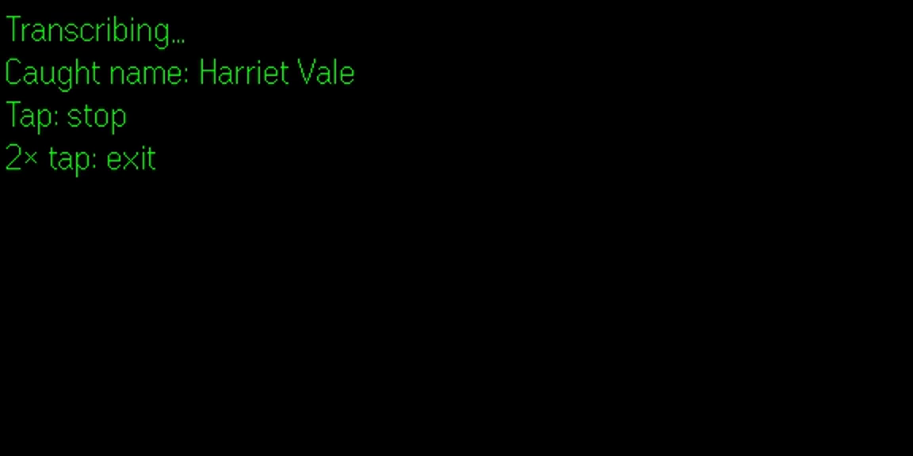

# Ostler Glance — Even Realities G2 ("Heads Up" hackathon, 23–29 Nov 2026)

A first-meeting memory for G2 smart glasses: catch a new person's
name/company/role from conversation, farm a person card at the end of the
meeting, and recall it the next time you meet them.

## Pitch

"Names are everyone's nemesis. Ostler Glance never forgets one."

## The demo (frames from the recorded video)

Live catch of a first meeting, held on screen:

The promise ledger — what you owe, how long it's been open:

## Architecture (this week)

- `glasses-app/` — G2 app (Even Hub SDK, TypeScript, Vite), scaffolded from
  the official `evenhub-templates/minimal`. Pairing-code sign-in (Google
  sign-in does not work in the WebView). Tap-to-start capture only, with a
  visible "Transcribing…" cue while capturing.
- `backend/` — text-in HTTP API (`API_CONTRACT.yaml`, OpenAPI 3.1). The
  backend contract is **text-only**: no raw audio endpoint exists; any
  audio content-type is refused.
- `stt/` — Studio-side faster-whisper service. The WebView streams
  16 kHz PCM from the mic; Whisper transcribes it; **audio is held in
  memory only and released after each request — never written to disk.**

## Models — all local, no cloud in the loop

- Speech-to-text: faster-whisper **base** on the Studio's MPS backend for
  live capture windows; small available for offline/farming-quality runs.
- Extraction (farming meeting artefacts): **qwen2.5:7b via local ollama**,
  two-call architecture — a promises-only call (the promise ledger is the
  differentiator, so it gets a dedicated, verifiable extraction) plus a
  four-artefact call (summary, to-dos, cleaned transcript, details).
  Extraction runs on qwen2.5:7b locally via ollama; no cloud model in the
  loop.

## Privacy

Nothing in this demo touches a cloud model; both Whisper and the
extraction model run on the owner's own machine. Audio is transcribed and
deleted — the STT service writes nothing to disk (tested). Notes live in
files the owner controls. Capture is tap-to-start, never always-on, with a
visible transcribing indicator. No voice print / speaker identification:
recall triggers are calendar/event match and name-said only.

## Fictional demo world

All people, companies and meetings are invented. See `FICTIONAL_WORLD.md`
for the canonical fixture. No real data is used anywhere in tests or demos.

## Development status

Built during the hackathon week (23–29 Nov 2026). Pre-existing tooling
(ollama runtime, faster-whisper libraries, Even Hub SDK packages) is
installed from public registries; all application code here was written
during the week. Backend tests: `node --test` in `backend/`.

## Rights

Open repo — viewing for judging; all rights reserved. No open-source
licence is granted, no licence file is included, and outside contributions
are not accepted. All fictional people, companies and meetings are
inventions; any resemblance to real persons or businesses is coincidental.
